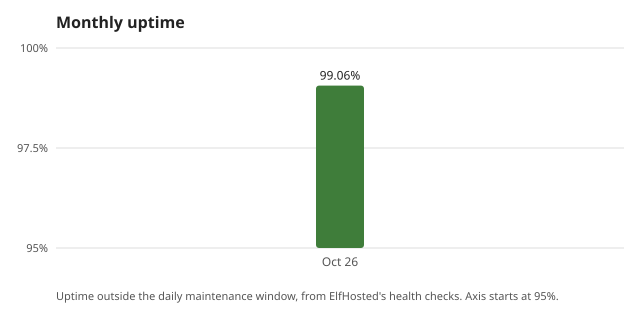

## How reliable has my ElfHosted stack been? {#by-the-numbers}

- In October 2026, my stack's measured uptime was 99.06% outside the daily maintenance window.
- Sam, Pip or my own agents carried out one change on my stack with my OK.

## Why ElfHosted instead of self-hosting or another host?

I ran Plex and the arrs on an old Synology for about three years. Every update broke something, and I was the only one who knew how to fix it. I wanted the same apps without being the sysadmin, and ElfHosted ran the ones I already used.

## Is ElfHosted what I expected?

I expected a cheap VPS with a control panel and a lot of reading. It was closer to an app store: I picked apps, they came wired together, and the docs covered the rest. The one thing I had to learn was how storage and debrid fit together.

## What can you run on ElfHosted?

Plex and AIOStreams for watching, Radarr and Sonarr for the shows I follow, Immich for phone photos and Mealie for recipes. Debridge brings my own Real-Debrid and TorBox accounts together.

The kinds of apps I run: AI Tools, Communication &#38; Social, Consume Media, Developer Tools, Download Media, Finance, Gaming, Health &#38; Wellbeing, Manage Downloads, Manage Media, Photos &#38; Video, Power Tools, Privacy &#38; Security, Productivity &#38; Notes, Rclone, Tools, other.

I watch on: Fire TV, Phone.

The apps I watch with: Stremio, Plex.

ElfHosted customer since 2024.

## What works well?

Immich surprised me most. I pointed the phone app at it once and it has backed up every photo since, including a 4,000 photo import from the old NAS that I expected to babysit.

## What goes wrong, and how does it get fixed?

In my second month Plex stopped finding new episodes for about a day. I asked in Discord, someone spotted that my Sonarr root folder pointed at the wrong mount, and once I changed it everything caught up overnight. Nothing has broken like that since.

## Has it changed my free time or family life?

My weekends are mine again. I used to lose a Saturday every month or so to updates and disk warnings. Now I spend maybe ten minutes a month on it, mostly adding things to watch.

## How useful is Sam, ElfHosted's AI assistant?

I use Sam when something looks off. It read my Sonarr logs and told me a quality profile was rejecting everything, which would have taken me an hour to find. It is less useful for questions about what to watch.

## What is ElfHosted support like?

Twice, both in Discord. Both times I had a reply within the hour, from a person, with the exact setting to change.

## Is ElfHosted worth the money?

Yes, for me. It costs a bit more than the electricity the NAS used, but I sold the NAS and got my weekends back.

## What are the downsides?

The number of apps is overwhelming at first, and some app pages in the docs assume you already know the app. A short start-here page for media streaming would help new people.

## Who is ElfHosted for, and who should skip it?

Anyone who wants Plex or Stremio working without running a server, and who is happy to follow a guide. If you enjoy tinkering with hardware, you will probably miss it.

_These come from my private ElfHosted monthly reviews: health checks every few minutes, with the announced daily maintenance hour left out._
